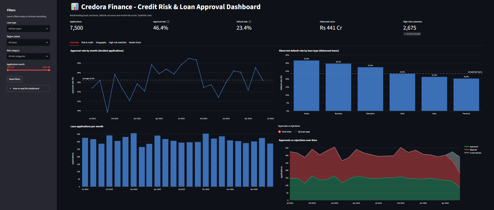
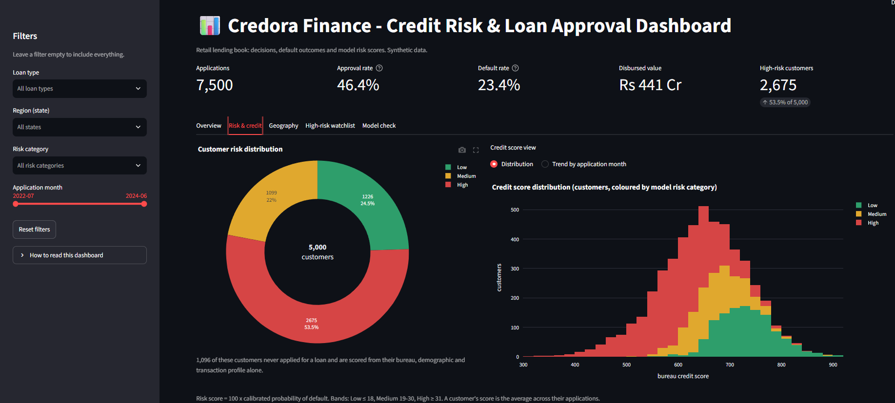
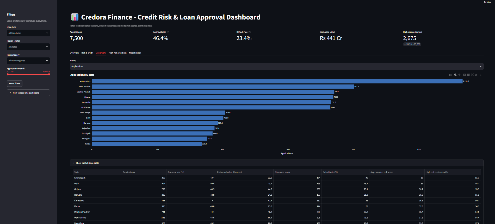
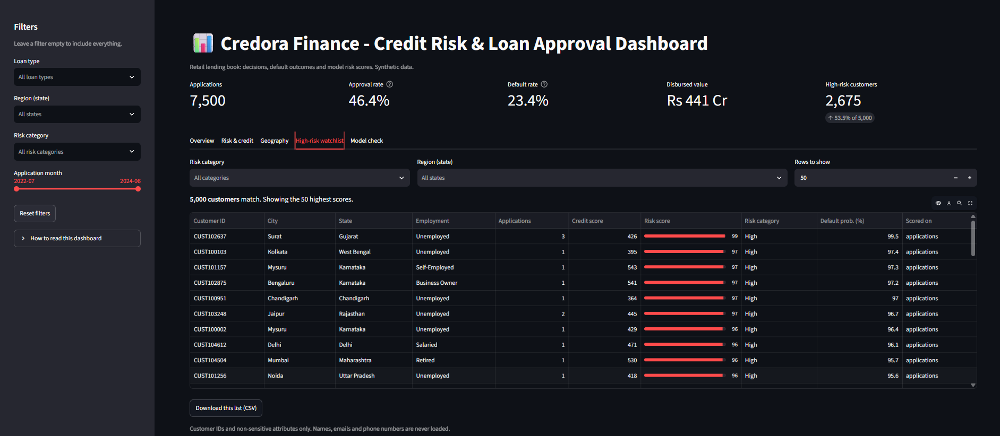

# Credit Risk & Loan Approval Analytics Platform

An end-to-end data science project for **Credora Finance**, a (synthetic) Indian retail lender. It takes raw customer, credit-bureau, loan-application and transaction data and turns it into:

1. a **relational MySQL database** with constraints and an analytical SQL layer,
2. a **default-prediction model** (probability that a loan will default, estimated before disbursal),
3. a **0–100 risk score** with Low / Medium / High categories, and
4. an interactive **Streamlit dashboard** for underwriters, risk managers and portfolio heads.

> **Data note:** all data is synthetic. Treat the numbers as an exercise in method, not as real lending performance.

## Screenshots

| | |
|:--:|:--:|
| **Overview**<br> | **Risk & credit**<br> |
| **Geography**<br> | **High-risk watchlist**<br> |

---

## Headline results

| Item | Result |
|---|---|
| Portfolio | 5,000 customers · 7,500 loan applications · 40,079 transactions |
| Observed default rate (disbursed loans) | **23.4%** (797 of 3,403) |
| Approval rate (decided applications) | **46.4%** |
| Champion model | **Logistic Regression** (best of 4 tuned models) |
| Cross-validated ROC-AUC | **0.742 ± 0.012** |
| Held-out test ROC-AUC | **0.718** |
| Test recall / precision at the tuned threshold | **0.65 / 0.37** |
| Default rate by risk category (out-of-fold) | Low ≈ **10%** → Medium ≈ **25%** → High ≈ **46%** |

**Honest reading of these results.** The original project brief set targets of ROC-AUC ≥ 0.80 and recall ≥ 0.70. On this dataset the **AUC target is not reached**: the test interval (about 0.67–0.76) lies entirely below 0.80, and four different model families all land between 0.71 and 0.74, which points to a ceiling in the data rather than a modelling mistake. The recall target is within statistical noise of being met (the test set has only 160 defaults). The score is useful for *ranking* risk, but it is a second opinion for an underwriter, not an automatic decision-maker. Details and limits are further down.

---

## Table of contents

- [Screenshots](#screenshots)
- [Pipeline at a glance](#pipeline-at-a-glance)
- [Project structure](#project-structure)
- [Quick start](#quick-start)
- [What each step does](#what-each-step-does)
- [The dashboard](#the-dashboard)
- [Key design decisions](#key-design-decisions)
- [Limitations and caveats](#limitations-and-caveats)
- [Troubleshooting](#troubleshooting)

---

## Pipeline at a glance

```
 4 raw CSVs ──► clean + load ──► MySQL ──► SQL analysis (10 queries)
                (data_load.py)     │
                                   ├──► EDA (notebook 01)
                                   │
                                   └──► features.py ──► train.py ──► default_model.pkl
                                        (34 features)   (4 models,      │
                                                         CV, calibrate) ▼
                                                                  risk_score.py
                                                                        │
                                          scored_customers + scored_applications (MySQL)
                                                                        │
                                                                        ▼
                                                            Streamlit dashboard
```

---

## Project structure

```
credit-risk-loan-analytics/
├── datasets/                       # raw data (not included in this repository)
├── sql/
│   ├── schema.sql                  # MySQL 8 tables, constraints, indexes
│   └── analysis.sql                # 10 analytical queries
├── src/
│   ├── data_load.py                # clean -> create schema -> load -> validate
│   ├── features.py                 # joins + feature engineering + preprocessing pipeline
│   ├── train.py                    # tune 4 models, calibrate, choose threshold, evaluate, save
│   └── risk_score.py               # probability -> 0-100 score -> Low/Medium/High -> MySQL
├── notebooks/
│   ├── 01_eda.ipynb                # exploratory data analysis
│   ├── 02_feature_engineering.ipynb
│   ├── 03_modeling.ipynb
│   └── 04_risk_scoring.ipynb
├── models/                         # created by train.py
│   ├── default_model.pkl           # pipeline + calibrator + threshold + metadata
│   ├── model_comparison.csv
│   ├── feature_importance.csv
│   └── metrics.json
├── dashboard/
│   └── app.py                      # Streamlit dashboard
├── documentation/
│   └── images/                     # dashboard screenshots used in this README
├── .env                            # your MySQL database details (private, never committed)
├── requirements.txt
└── README.md
```

---

## Quick start

### 1. Prerequisites

| Tool | Version |
|---|---|
| Python | 3.10 or newer |
| MySQL Server | **8.0.16 or newer** (older versions silently ignore the CHECK constraints) |
| Disk / RAM | small: a normal laptop is fine |

Your MySQL user needs permission to create a database.

### 2. Set up the project

```bash
# from the project folder
python -m venv venv

# activate it
venv\Scripts\activate            # Windows
source venv/bin/activate         # macOS / Linux

pip install -r requirements.txt
```

### 3. Add the data

Place the project's raw data files in the `datasets/` folder. They are not included in this repository.

### 4. Add your database details

Create a `.env` file in the project root with your MySQL database details. It stays private and is never pushed to GitHub.

### 5. Run the pipeline (from the project root)

```bash
python src/data_load.py          # clean + load into MySQL + validation report
python src/train.py              # train and evaluate the models (about 2 minutes)
python src/risk_score.py         # score every application and customer, write to MySQL
streamlit run dashboard/app.py   # open the dashboard in your browser
```

Each command must finish before the next one starts, because each step uses the output of the previous one.

**What you should see**

| Step | Success looks like |
|---|---|
| `data_load.py` | `RESULT: ALL CHECKS PASSED`, row counts 5,000 / 5,000 / 7,500 / 40,079, approval rate 46.4%, default rate 23.4% |
| `train.py` | A model comparison, the champion named, test-set metrics, and files saved to `models/` |
| `risk_score.py` | `Wrote tables: scored_applications, scored_customers` and a Low / Medium / High breakdown |
| dashboard | Opens at `http://localhost:8501` |

### 6. Optional: SQL analysis and notebooks

- Open `sql/analysis.sql` in MySQL Workbench and run the 10 queries.
- Open the notebooks in VS Code or Jupyter and run them **in order**: 01 → 02 → 03 → 04. Notebook 03 retrains the models and notebook 04 rewrites the scored tables, so they reproduce the same results as the scripts.

---

## What each step does

### Data loading and cleaning: `src/data_load.py`

One command that is safe to re-run (it rebuilds the tables each time):

- trims whitespace, normalises IDs and emails, parses dates;
- checks duplicate keys, orphan foreign keys and value ranges;
- creates the database and the four tables from `sql/schema.sql`;
- loads in dependency order and prints a validation report that compares the loaded data with the project brief.

The source data was already clean in structure. The one real finding: two pairs of customers share an email address. They are different customer IDs, so they are kept and logged, and email is never used in modelling.

### SQL analysis: `sql/analysis.sql`

Ten queries covering credit-score bands, monthly approval trends, customer segmentation, a rule-based high-risk list, default rate by loan type, loan-amount distribution (including a true median), monthly approval statistics, a rule-based risk categorisation, transaction behaviour and top default drivers. They were ported from PostgreSQL to MySQL; three queries also had logic corrections (documented in comments in the file).

### Features: `src/features.py`

One row per **disbursed** loan, with **34 features** in four groups:

| Group | Examples |
|---|---|
| Demographic | age, dependents, tenure, employment type, education, residence type |
| Credit bureau | credit score, utilisation, late payments (30/90 days), prior defaults, inquiries, credit limit |
| Application | requested amount, interest rate, term, debt-to-income, loan-to-income, EMI-to-income, loan type, collateral |
| Transaction behaviour | 6-month inflow, outflow, net cash flow, EMI outflow, average balance, inflow/outflow ratio |

It also contains the preprocessing pipeline (median imputation, scaling where needed, one-hot encoding), fitted on training data only.

### Modelling: `src/train.py`

1. Split 80/20, **stratified on the outcome and grouped by customer**.
2. Tune four models with 5-fold grouped cross-validation on the training set: Logistic Regression, Decision Tree, Random Forest, XGBoost.
3. Pick the champion by cross-validated ROC-AUC.
4. **Calibrate** the probabilities (Platt scaling on out-of-fold predictions) so that a predicted 30% really means about 30%.
5. Choose the decision threshold on training data only: the highest threshold that still reaches 70% recall.
6. Evaluate **once** on the held-out test set.

| Model | CV ROC-AUC |
|---|---|
| **Logistic Regression** | **0.742 ± 0.012** |
| XGBoost | 0.732 ± 0.013 |
| Random Forest | 0.723 ± 0.017 |
| Decision Tree | 0.710 ± 0.017 |

The simple model matches the complex ones within noise, so it wins on speed and explainability.

Strongest predictors: **debt-to-income ratio**, **credit score**, recent late payments, employment type and loan term. SHAP plots and a per-applicant explanation are in notebook 03.

### Risk scoring: `src/risk_score.py`

`risk_score = round(100 × calibrated probability of default)`

| Category | Score | Actual default rate (out-of-fold) |
|---|---|---|
| Low | 0 – 18 | ≈ 10% |
| Medium | 19 – 30 | ≈ 25% |
| High | 31 – 100 | ≈ 46% |

Output tables written to MySQL:

- `scored_applications`: one row per application (7,500)
- `scored_customers`: one row per customer (5,000), the average over the customer's applications

You can change the risk appetite by editing `LOW_MAX` and `MEDIUM_MAX` at the top of `risk_score.py`.

---

## The dashboard

Run it with `streamlit run dashboard/app.py` from the project root.

| PRD component | Where to find it |
|---|---|
| 1. Loan approval rate | KPI card + monthly trend (Overview) |
| 2. Default rate | KPI card + default rate by loan type (Overview) |
| 3. Customer risk distribution | Donut chart (Risk & credit) |
| 4. Credit score view | Histogram or trend by application month (Risk & credit) |
| 5. Geographic distribution | State bar chart with selectable metric (Geography) |
| 6. Monthly loan applications | Column chart (Overview) |
| 7. Approval vs rejection | Area chart over time, or grouped bars by loan type (Overview) |
| 8. High-risk customer list | Filterable table with CSV download (High-risk watchlist) |

A **Model check** tab shows whether the score really separates good loans from bad ones, plus a model summary.

**Filters** (sidebar): loan type, region (state), risk category, application month. **Leave a filter empty to include everything**; pick one or more values to narrow the view. The *Reset filters* button restores the defaults.

The dashboard loads only IDs and non-sensitive attributes. Names, emails and phone numbers are never read or shown.

---

## Key design decisions

| Decision | Why |
|---|---|
| Train only on **disbursed** loans (3,403) | Only they have a known outcome; rejected loans have no label |
| Split train/test **by customer** | 809 customers have several disbursed loans; a plain row split would let the model see the same customer in both sets |
| Exclude `approval_status`, `approved_amount`, `decision_date`, `disbursed_flag` | They are only known *after* the decision (target leakage) |
| Aggregate transactions to one row per customer before joining | A direct join would repeat every loan once per transaction; the join is also guarded with `validate="m:1"` |
| Drop redundant columns | Monthly income equals annual income ÷ 12; account age tracks age (correlation 0.99); a debt-to-limit ratio I tried equalled credit utilisation |
| Measure tenure at the bureau snapshot date | About 12% of customers joined *after* their application date, which would give negative tenure |
| Calibrate probabilities | Class weighting inflates raw probabilities; a risk score must reflect real frequencies |
| **Tuned** risk bands (18 / 30) instead of 33 / 66 | With 33 / 66, 79% of loans were "Low" and that group still defaulted at 16.6%; 18 / 30 separate risk much better |
| Score disbursed loans with **out-of-fold** predictions | A loan is never scored by a model that trained on it, so the validation is honest |
| Report the missed AUC target openly | A truthful result with its limits is more credible than a forced 0.80 |

---

## Limitations and caveats

1. **Synthetic data.** Findings describe this dataset, not real borrowers.
2. **AUC about 0.72, below the 0.80 target.** Every model family hits the same ceiling, so the limit is in the data. The test set is small (682 loans, about 160 defaults), so all test metrics carry roughly ±0.04 of uncertainty.
3. **Timing mismatch.** Bureau and transaction snapshots are from 2024, while many loans were disbursed in 2022. In a real bank this would be a data-timing problem and would likely overstate performance.
4. **Scores for rejected and under-review applications are extrapolations.** The model never saw their outcomes, so their calibration cannot be verified. They are best read as a relative ranking.
5. **1,096 customers never applied for a loan.** They are scored from bureau, demographic and transaction data only (marked `profile only`, with loan details filled by portfolio medians).
6. **Risk-band cut-offs were tuned on the same out-of-fold data**, so the separation shown is slightly optimistic.
7. **Small groups are weakly supported.** Only 24 training loans were to unemployed borrowers, so their (very high) scores are closer to extrapolation than learned experience.
8. **No causal claims.** For example, higher interest rates are associated with lower default risk in this data, probably because of the loan-type mix. Do not read model coefficients as advice.
9. **Transaction features add no measurable lift** over the other features in an ablation test. They are kept because the project brief asks for them.
10. **Fairness.** Gender, marital status and location are not model inputs, but no formal bias audit has been done. That would be required before any real-world use.

---

## Troubleshooting

| Problem | Fix |
|---|---|
| A message about missing values in `.env` | Check that your `.env` file exists in the project root and contains your MySQL database details |
| `Access denied for user` / cannot connect | Check that MySQL is running and that the details in your `.env` file are correct |
| A raw data file is reported missing | Make sure the raw data files are in the `datasets/` folder |
| Warning about MySQL version below 8.0.16 | Upgrade MySQL; older versions ignore the CHECK constraints |
| `default_model.pkl not found` | Run `python src/train.py` first |
| Dashboard says it cannot read the data | Run `data_load.py`, then `train.py`, then `risk_score.py`, in that order |
| `ModuleNotFoundError` | Activate the virtual environment and run `pip install -r requirements.txt` |
| Model file will not load on another machine | Pickled models depend on library versions; run `python src/train.py` on that machine to rebuild it |
| Streamlit imports fail | Run the command from the project root: `streamlit run dashboard/app.py` |

---

## Author

*Samar Markande*
